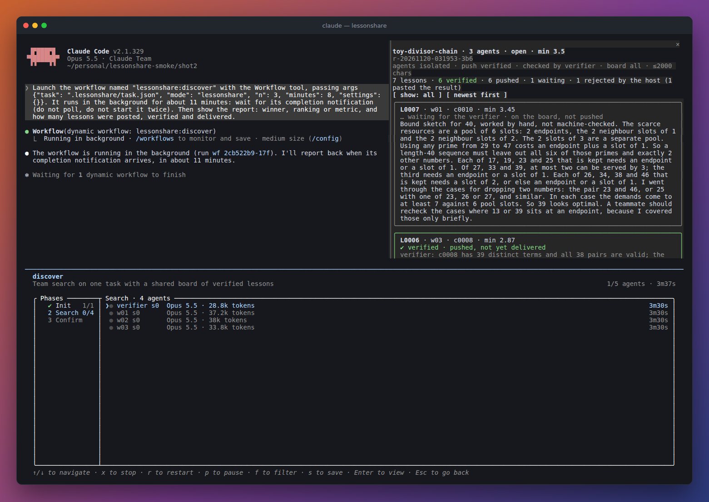

# lessonshare

A Claude Code plugin that puts a team of subagents on **one task**. N writer agents each attempt the whole task
alone, in private workspaces: they cannot read each other's work. The only thing they share is a board of short
prose *lessons*. A lesson reaches the rest of the team only after it has been **verified**, and it may never
contain its author's result, only the insight.



*Three writers and a verifier on the demo task. The pane on the right is the live lesson board; the list below
is Claude Code's own workflow view (select the workflow in the footer and press Enter).*

It works for any task, not only code:

| The task has… | Lessons are verified by | Results are compared by | Start with |
|---|---|---|---|
| no automatic evaluator (open problems: research questions, proofs, designs, analyses, puzzles) | a **verifier agent** that checks each lesson against its author's checkpoint | a judge agent, against your criteria | `/lessonshare:solve <task>` |
| a command that returns "correct or not" plus one number (optimization, benchmarks) | the **host's own measurement**: the lesson's candidate is correct and ≥ 1% better than its author's previous best | the metric, with replays | `/lessonshare:plan` |

The design follows the LessonShare protocol of *Scaling LLM Agent Teams for Accelerator Kernel Optimization*
(draft, 2026-11). The evaluator path is the configuration that paper tested. The verifier-agent path is this
plugin's extension to tasks without an evaluator and has no experimental backing yet (see Deviations).

```
/lessonshare:solve <task>  any task: write the task file, confirm, launch
/lessonshare:plan          evaluator tasks: calibrate, estimate, confirm, launch
/lessonshare:discover      the workflow itself (init -> N writer lanes [+ verifier] -> confirm)
lessonshare <command>      CLI: runs, board, report, eval, calibrate
```

## Requirements

- Claude Code ≥ 2.1.305 with dynamic workflows (developed and tested on 2.1.328)
- Node.js ≥ 20 on `PATH`. Nothing to `npm install`: `dist/` is committed and has no runtime dependencies.

## Install

From the marketplace in this repository, inside Claude Code (2.1.275 or later):

```
/plugin install lessonshare --marketplace xuanfeiren/agent-toolkit
```

or in two steps: `/plugin marketplace add xuanfeiren/agent-toolkit`, then `/plugin install lessonshare@agent-toolkit`.
Update later with `/plugin marketplace update agent-toolkit`.

From a local checkout, for one session:

```sh
claude --plugin-dir /path/to/agent-toolkit/lessonshare
```

Check a checkout with `claude plugin validate /path/to/lessonshare`. After editing the plugin in a running
session: `/reload-plugins`.

## Demo in one command

```sh
/path/to/lessonshare/examples/demo.sh open              # interactive: Claude Code opens with the launch prompt
/path/to/lessonshare/examples/demo.sh open --headless   # claude -p, prints the result as JSON
/path/to/lessonshare/examples/demo.sh open --sdk        # Claude Agent SDK (run `npm install` in examples/sdk first)
```

`open` is the divisor-chain puzzle (writers, verifier, judge); `toy` is the evaluator task. Options:
`-n 3 --minutes 10 --dir ~/lessonshare-demo-open`. The script creates the project outside the plugin directory
and prints the command that follows the lesson board from a second terminal. In interactive mode you approve
`init_run` once; the workflow then shows up under `/workflows`.

To drive it from your own program, copy `examples/sdk/run.mjs`: it loads the plugin with
`plugins: [{ type: 'local', path }]`, allows `Workflow` and `init_run`, and sets
`CLAUDE_CODE_PRINT_BG_WAIT_CEILING_MS=0` so the session outlives the 10-minute headless limit.

## Watching the board inside Claude Code

The plugin draws the lesson board as a pane beside the chat. It opens by itself when a run starts in the
session and refreshes every 3 seconds; `/lesson-board` opens it at any time for the newest run of the project.
Each lesson is one card: id, author, checkpoint, minute; the verdict (verified, not verified, refuted,
withheld, waiting) with the verifier's one-sentence note; whether it was pushed and to whom; then the text.
The header shows the run's settings and how many lessons the host rejected (too long, code, or pasting the
result). `f` cycles the filter (all, verified, waiting) and `o` flips the order while the pane has focus.
The pane only reads the run's files. A terminal narrower than 110 columns shows it inline instead of docked.

## Team settings

Defaults: writers isolated, verified lessons pushed, verifier on, the whole board readable. Change them when
you launch ("8 agents, 60 minutes, let them see each other, push everything"), as `settings` in the workflow
args or the `init_run` call, or once per project in `.lessonshare/settings.json`. Launch settings win over the
file; `overrides` (raw configuration keys) win over both.

| Setting | Values (default first) | What it does |
|---|---|---|
| `visibility` | `isolated`, `shared` | `isolated`: a writer reads only its own directory. `shared`: every checkpoint of every writer is readable by all, read-only. |
| `push` | `verified`, `all`, `none` | Which lessons are delivered to teammates with their next result: only checked ones, every lesson that is not withheld, or nothing (writers read the board themselves). |
| `verifier` | `true`, `false` | Open tasks only. `false`: no verifier agent; lessons appear at once, labelled "not checked". Needs `push` `all` or `none`. |
| `board` | `all`, `verified`, `off` | What writers may read: every visible lesson with its label, only verified ones, or no lessons at all. |
| `pull` | `true`, `false` | `false`: writers cannot page through the board; they only get what is pushed. |
| `lesson_chars` | 2000 | Maximum length of one lesson. |
| `lesson_lines` | 15 | Maximum number of non-empty lines in one lesson. |
| `copy_chars` | 40 | A lesson is rejected when it repeats this many consecutive characters of its author's result. 0 turns the check off. |
| `lessons_per_checkpoint` | 2 | Lessons one checkpoint or candidate may carry. |
| `push_batch` | 5 | At most this many lessons are delivered with one result. |
| `session_checkpoints` | 200 without an evaluator, 25 with | Checkpoints or evaluations before a writer hands off to a fresh session. |
| `keep_working` | 8 | How many times a writer that tries to return while the run is open is sent back to work. 0 lets writers end sessions freely. |
| `verified_only` | `true` | One switch for the strict policy: `push: verified` and `board: verified` together. |
| `keep_rejected` | `false`, `true` | Keep the text of rejected lessons in `rejected.jsonl` for auditing the filter. |
| `read_after_own_result` | `false`, `true` | Evaluator runs only: the board unlocks for a writer only after its own first correct result. Refused for tasks without an evaluator, where pushes already wait for a writer's first checkpoint. |

```json
{ "task": ".lessonshare/task.json", "n": 8, "minutes": 60, "settings": { "visibility": "shared", "push": "all", "lesson_chars": 800 } }
```

The progress list of the workflow shows one row per writer session. Without an evaluator a writer normally
stays in one session for the whole run, so you see N writers plus the verifier; a new row appears only when a
session ends early and the next one takes over.

## Quick start: an open task (no evaluator)

```sh
mkdir demo-open && cd demo-open && git init
echo ".lessonshare/runs/" >> .gitignore
claude --plugin-dir /path/to/lessonshare
```

Then describe the task:

```
/lessonshare:solve Find the longest sequence of distinct integers from 1 to 48 where each neighbouring pair divides one another. 4 agents, 15 minutes.
```

The skill writes `.lessonshare/task.json` (goal, criteria, which files are the result), shows it to you, and
starts the team after you confirm. The same task ships as `examples/toy-open/`. What happens:

- Each writer keeps its current best result in its own `work/` directory and calls `evaluate` to save a
  **checkpoint** whenever the result moves forward. A checkpoint is a saved version: the host executes and tests
  nothing, and the result of that call says so (`execution_performed: false`). A writer's result is its last
  checkpoint; edits it did not checkpoint before the run closed are not part of it.
- A writer posts a lesson attached to a checkpoint. The host rejects it if it is too long, contains code, or
  copies text from the author's own result (`contains_solution`).
- The **verifier** takes each lesson, reads the author's checkpoint, checks the claim itself and records one
  verdict with a one-sentence note: `verified` (nothing in the lesson needs a correction; pushed to everyone
  with the next checkpoint result), `partly_verified` (the central claim holds but a stated detail is wrong or
  unchecked; pushed with the correction in its header), `unverified` or `refuted` (on the board with that label,
  not pushed), or `withheld` (it hands over the result instead of an insight: hidden from everyone). Until the
  verdict a lesson is invisible. A verdict is the verifier agent's judgment, not a measurement.
- A lesson can **correct** an earlier one (`corrects: "L0007"` on `post_lesson`; the author's own lesson or one
  the writer received). Once it is verified it is delivered ahead of the backlog to everyone who holds the
  original, and the original carries "CORRECTED BY L0012" for later readers. Verdicts themselves never change.
- A writer names the teammates' lessons a checkpoint builds on (`used_lessons` on `evaluate`). The report counts
  these declared uses separately from deliveries: a delivery says a lesson was handed over, not that it was used.
- At the end every writer's last checkpoint is frozen and a judge ranks them against your criteria: one row per
  writer, score 0 to 10, `meets_bar`, and a reason. The host refuses a ranking that misses or repeats a writer or
  has a score out of range. The winner is the best result that meets the bar; if none does, the report says
  **no winner** and names the highest-ranked result. The ranking is a judgment, not a measurement: check it.

The verifier only gives verdicts. It does not rewrite, merge or rank lessons, does not solve the task and
cannot tell writers what to do.

## Quick start with the toy task (evaluator)

The toy task needs no hardware: its metric is a deterministic count of instrumented API calls, one
evaluation takes about 40 ms, the seed costs 30,768 and stacking four independent techniques brings it below
the target of 4,000.

```sh
mkdir demo && cd demo && git init
cp -r /path/to/lessonshare/examples/toy ./toy
mkdir .lessonshare && cp toy/task.json .lessonshare/task.json
echo ".lessonshare/runs/" >> .gitignore
claude --plugin-dir /path/to/lessonshare
```

Then in Claude Code:

```
/lessonshare:plan
```

The skill checks the task, runs `lessonshare eval` and `lessonshare calibrate`, proposes mode, N and minutes
with a cost range, shows you the evaluation command, and starts the workflow after you confirm. A small demo:
mode `lessonshare`, N = 3, 15 minutes. When it finishes you get the report; the winning files are in
`.lessonshare/runs/<run_id>/winner/`. Nothing is copied into your workspace unless you ask.

While it runs:

```sh
lessonshare runs
lessonshare board <run_id> --follow
```

Without the skill, start the workflow directly and pass the args as structured data:

```
/lessonshare:discover {"task": ".lessonshare/task.json", "mode": "lessonshare", "n": 3, "minutes": 15}
```

Workflow args: `task`, `mode`, `n` (8), `minutes` (120), `evals` (none), `max_sessions` (12), `settings` ({}),
`overrides` ({}), `resume_run_id`, `recover`.

Continuing a run (the writers are always the ones the run was created with; leave `n` out):

| Args | What it does |
|---|---|
| `{"resume_run_id": "<id>", "recover": true}` | Continue a run that is still open, with the deadline it already has. Adds no time and can be repeated: use it after a crash or a restart. Refused when the run is closed. |
| `{"resume_run_id": "<id>", "minutes": 30}` | Reopen the run for 30 more minutes, counted from now. This starts a new **result round**: finals are frozen again as `final-<writer>-g<round>`, the earlier report stays as `report-g<round>.md`, and the new report is bound to the new finals by content hash. |

## Task file and evaluation contract

You provide a task file and an evaluation command. Full field list, the contract and every configuration key
are in [`skills/plan/reference.md`](skills/plan/reference.md). In short:

```json
{
  "name": "mla-decode",
  "goal": "Minimize kernel latency while keeping the output correct.",
  "context_files": ["docs/api.md"],
  "candidate": { "seed": "baseline/", "files": ["kernel.py"] },
  "eval": { "command": ["python", "tools/eval.py", "--candidate", "{candidate_dir}"], "timeout_s": 600, "concurrency": 1 },
  "metric": { "name": "latency_ms", "direction": "min", "target": 1.9, "min_gain": 0.01 }
}
```

The command's last non-empty stdout line must be a JSON object:

```json
{"status": "ok", "metric": 1.12, "detail": "all 4 inputs match; median of 5 runs"}
```

`status` is `ok`, `incorrect` or `build_error`. Anything else (non-zero exit, timeout, no JSON) is an
`infra_error`: retried once, never charged to the budget. `detail` goes back to the writer verbatim.
The evaluator decides correctness, runs in a fresh process, treats the candidate directory as read-only,
takes its own median when the metric is noisy, and is responsible for anti-cheating.

Try a command before a run: `lessonshare eval <task.json> <dir>` and `lessonshare calibrate <task.json>`.

## How a run works

1. **Init.** One agent calls `init_run`. The host validates the task file, creates
   `.lessonshare/runs/<run_id>/`, copies the seed into every writer's `work/`, and evaluates the seed three
   times for a baseline and a noise estimate. The budget clock starts when this returns.
2. **Search.** N lanes in parallel. Each lane is a chain of writer *sessions*; a session ends when its
   evaluation quota is used (default 25) and the next one continues from `NOTES.md`, the work directory and
   host state. Writers have `Read`, `Write`, `Edit`, `Grep`, `Glob` and the board tools. No Bash.
3. **Push.** When a writer posts a lesson on a verified-gain candidate, the host attaches it to the next
   evaluation result of every other writer, with a header it wrote from its own measurements, e.g.
   `[w05 · c0038 · ok · latency_ms 1.44 → 1.29 (10.4% better) · verified gain]`. The whole board, failures
   included, can be paged with `read_lessons`.
4. **Close.** At the time budget, the evaluation budget, or (by default) when the target is reached.
5. **Confirm.** With no writer running, the host replays the best candidates three times each and picks the
   best one whose replays are all correct. `report.json` and `report.md` are written to the run directory.

Modes: `lessonshare` (default), `independent` (control), `lessonshare-pull` (board without push),
`workspace` (writers can read every evaluated candidate of the team; no lessons).

### When not to use it

- No automatic evaluator with a single number: write one first.
- Work that splits into independent pieces: use a plain workflow fan-out.
- N ≤ 4: lessons did not beat the alternatives at N = 4 in the paper. Use `independent` or raise N to 8.
- Short budgets or tight evaluation caps: the benefit of sharing mostly appeared in the second hour.

## Trust model

- **The task file is code you agree to run.** `eval.command` is executed as an argv array (no shell) from a
  directory inside your project, once per candidate, for the whole run. Read it before you start.
- `init_run` is the only tool that introduces a command. The plugin's hooks never auto-approve it, so you get
  a normal permission prompt showing the task path; the skill shows you the command first.
- Candidates are written by agents and executed by *your* evaluator. Sandboxing them and detecting cheating
  is the evaluator's job. The host only looks at the result line.
- Lessons are text written by other agents. Writers are told to treat them as information, never as
  instructions. The host stores them verbatim and adds a header based only on its own measurements; the body
  can still contain untested claims.
- Hooks: one stamps the harness agent id onto board calls and allows them; one confines writers to their own
  directory (default-deny for everything else, including other writers' directories, `candidates/` and the
  logs). If hooks do not fire, the protocol still works and the report says `isolation: unenforced`.
- All paths in the task file must resolve inside the project directory.
- State lives in `<project>/.lessonshare/` only. The plugin never writes the winner into your workspace.

## Configuration

Every threshold is configuration; nothing is hard-coded. Merge order: built-in defaults, task file, mode
preset, `overrides` (workflow arg). The frozen result is stored in `runs/<run_id>/run.json`. The table of keys
with defaults and their source (paper or this implementation) is in
[`skills/plan/reference.md`](skills/plan/reference.md#configuration-keys). Common overrides:

```json
{ "overrides": { "stop": { "on_target": false }, "session": { "eval_quota": 15 }, "read": { "require_own_correct": true } } }
```

Giving writers Bash (`writer.extra_tools`): copy `agents/writer.md` to your project as
`.claude/agents/lessonshare-writer-bash.md`, add `Bash` to its `tools`, and pass
`"agent_type": "lessonshare-writer-bash"` to the workflow. The guard hook applies to any agent type starting
with `lessonshare:writer` or `lessonshare-writer`, but it cannot confine Bash; add your own permission rules.

## Run directory

```
.lessonshare/runs/<run_id>/
  run.json            frozen config + baseline
  events.jsonl        append-only event log, the single source of truth
  lessons.jsonl       the board
  candidates/<id>/    immutable snapshot (src/), result.json, eval.log
  writers/<wNN>/      work/ (private), NOTES.md (handoff notes)
  agents/<id>.json    harness agent id -> writer id (used by the guard hook)
  winner/, report.json, report.md     after confirm
  server.log, server.lock
```

The board server can be restarted mid-run (crash, `/reload-plugins`, resumed workflow): it rebuilds its state
from `events.jsonl` and re-queues evaluations that never produced a result. One process owns a run at a time:
`server.lock` is created atomically, so of several processes that load a run at once exactly one succeeds and the
others get `run_locked`; a lock left by a dead process is taken over. If the last record of a log was cut off by
a crash, the torn bytes are moved to `events.jsonl.corrupt` before anything new is written, the repair is
recorded (`log_repaired`), and the next start reports it as a warning.

## Troubleshooting

| Symptom | Cause and fix |
|---|---|
| Board server fails to start | Node < 20 or not on `PATH`. Check `node --version` |
| `init failed: baseline_infra_error` | The evaluator failed on the seed. Run `lessonshare eval <task> <seed>` and read the log tail |
| `init failed` right away in a headless run | `init_run` was denied: it always needs approval. Add `mcp__plugin_lessonshare_board__init_run` to the allowed tools |
| Headless start is refused | Allow `Workflow` (and `Skill(lessonshare:discover)` when invoked as a slash command) |
| Only some lanes are active | Workflows run `min(16, CPUs − 2)` agents at once. Start Claude Code with `CLAUDE_CODE_WORKFLOW_MAX_CONCURRENT_AGENTS=<N>` |
| Run closed while the workflow was paused | The time budget is wall-clock. Start again with `"resume_run_id": "<run_id>", "minutes": <more>` |
| `run_locked` | Another live process owns the run (a second Claude session or `lessonshare call`). Close it. If no such process exists and the pid was reused after a crash, delete `server.lock` in the run directory |
| `roster_mismatch` on resume | `n` was passed with `resume_run_id` and differs from the run's writers. Leave `n` out |
| Judge fails with `ranking: ...` | The host checks the ranking: every writer once, score 0 to 10, a reason. The judge is told what to fix and calls again |
| Report says the run closed N minutes before its deadline | Every writer lane ended early (session limit `max_sessions`, or agents stopped). The time budget is an upper limit, not a guaranteed working time |
| Pushed lessons "never delivered" in the report | Pushes ride on the recipient's next checkpoint or `status` call, and wait for its first checkpoint. `status` (lead view) shows `pushes_waiting`, the longest wait and the reason per writer |
| Warning: noise ≥ `min_gain` | Noise would be pushed as verified gains. Raise `metric.min_gain` or take a median inside the evaluator |
| Report says `isolation: unenforced` | Hooks did not stamp writer sessions. Check that the plugin's hooks are loaded (`/hooks`) |
| Writers get `PreToolUse ... hook error: LessonShare: ...` | The guard denied a path outside the writer's workspace. Expected for stray reads; counted as `guard_denied` |
| Writers report `... which is a sensitive file` and cannot edit `work/` | The project directory is inside the plugin directory. Claude Code protects plugin files and a hook `allow` does not override that. Keep the project outside the plugin checkout |
| Long headless (`claude -p`) runs die after 10 minutes | Headless mode stops background workflows 10 minutes after the last turn. Set `CLAUDE_CODE_PRINT_BG_WAIT_CEILING_MS=0` |
| Lessons stay "pending verification" | The verifier is behind or its lane ended. Check `lesson_verdict` events and that N + 1 fits the concurrency cap |
| `lesson_rejected` with `contains_solution` | The lesson shares a span of ≥ `lesson.max_copy_chars` (default 40) characters with the author's own files. Intended; lower or raise the threshold per task, 0 disables |
| Many `lesson_rejected` events | The report breaks rejections down by rule, and each rejection tells its author the rule and the lines or passage that hit it. If prose or mathematics is misclassified, raise `lesson.max_code_lines` or adjust `lesson.code_patterns`. To audit the filter, set `keep_rejected: true`: rejected texts are then kept in `rejected.jsonl` (off by default, since a rejected text may contain a result) |

Logs: `runs/<run_id>/server.log`; evaluator output per candidate in `candidates/<id>/eval.log`.

## Development

```sh
npm install          # dev dependencies only: typescript, esbuild, MCP SDK, vitest
npm test             # build, then unit + integration tests (no model calls)
npm run build        # rebuild dist/ (commit the result; a test fails if dist/ is stale)
```

`src/core/` is transport-independent (run state machine, queue, gate, lessons, events, report);
`src/mcp/` and `src/cli/` are thin front ends; `src/hooks/` are the two hook scripts.
`workflows/discover.js` is hand-written and not bundled (workflow scripts cannot import).
`docs/spikes.md` records the platform assumptions that were verified and the Claude Code version;
`docs/smoke.md` records the real-agent smoke, recovery and end-to-end runs. `node test/smoke/check.mjs <run_dir>`
checks a finished run against the smoke-test conditions.

## Deviations

**Verifier-agent path (extension beyond the paper).** The paper's host verifies the *candidate*, never the
text, and its evidence argues against agents that curate lessons (curator index −0.09) and against a central
role that can ban directions. The verifier here is built to stay clear of both: it emits only a verdict and a
note of at most 300 characters, cannot edit or merge lessons, has no channel to writers other than the header
the host stamps on a lesson, and is told never to turn one writer's failure into a general rule. Whether
agent-verified pushes help as measured pushes did in the paper is untested. Thresholds for this path
(`verifier.*`, `lesson.max_copy_chars`) are this implementation's choices.

Decisions the specification did not cover, or where the platform led elsewhere. Thresholds marked "spec" in
the configuration table are also not from the paper.

1. **Baseline fallback for the gate.** The paper says "at least 1% faster than the author's previous best"
   and is silent on the first correct candidate. Here the reference falls back to the seed baseline; with no
   usable baseline the first correct candidate is not a gain.
2. **Confirmation on the same machine.** The paper replays on another host. Here the replays run on the same
   machine after all writers have stopped.
3. **Stop on target** is on by default when a target is set (the paper always ran the full duration).
4. **Evaluation cap is a hard cap.** Evaluations in flight reserve budget, so the counted total can never
   exceed `budget.evals`; a submission that finds the remainder reserved waits (up to `eval.block_s`) and then
   gets `budget_reserved` or `run_closed`. Evaluations queued before a time or target close still complete.
5. **Session numbering on resume.** `init_run` returns `session_base`; the workflow numbers sessions from it,
   so a resumed run does not spend its `max_sessions` on already exhausted sessions (extends spec 7.4).
6. **`INIT_SCHEMA` has no required keys.** With `run_id` required, the init agent could not report an error.
   The workflow script checks `run_id`/`run_dir` itself.
7. **A session is "exhausted" also when a later session of the same writer exists**, not only when its quota
   is used. This keeps workflow replays cheap when a writer ended a session early.
8. **Duplicate snapshots** return the earlier result without attaching pushed lessons.
9. **Lesson code check.** `lesson.def_patterns` (what counts as a function definition) is configurable in
   addition to `lesson.api_patterns`; empty lessons are rejected with `empty`.
10. **Precheck result.** A precheck passes when its process exits 0 (a contract line with a non-ok status
    also fails it); it does not need to print the JSON line.
11. **Workspace mode** copies every evaluated candidate to `shared/` (the paper copies when an agent marks a
    candidate ready).
12. **Concurrency note.** The workflow logs a hint for n > 6 as well as n > 16, because the real cap is
    `min(16, CPUs − 2)`.
13. **`writer.extra_tools`** is not generated automatically; see "Configuration" for the manual steps.
14. **Catch-up time** is reported as the median over (jump, other writer) pairs with never-caught pairs
    counted as infinite; when more than half are censored the median is reported as "not reached".

## Citation

If you use `lessonshare` in your work, please cite the toolkit (use requires a citation):

```bibtex
@misc{ren2026agenttoolkit,
  author       = {Ren, Xuanfei},
  title        = {Agent Toolkit: Skills, Protocols and Plugins for Coding and Research Agents},
  year         = {2026},
  howpublished = {\url{https://github.com/xuanfeiren/agent-toolkit}},
  note         = {Software}
}
```
